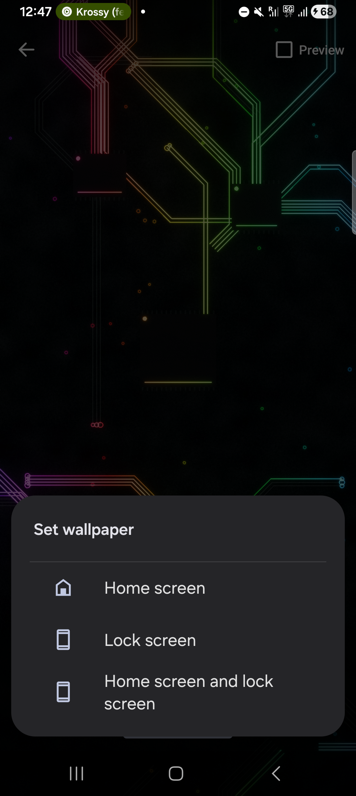
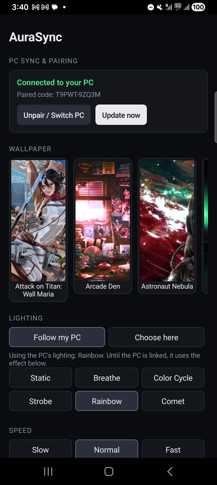
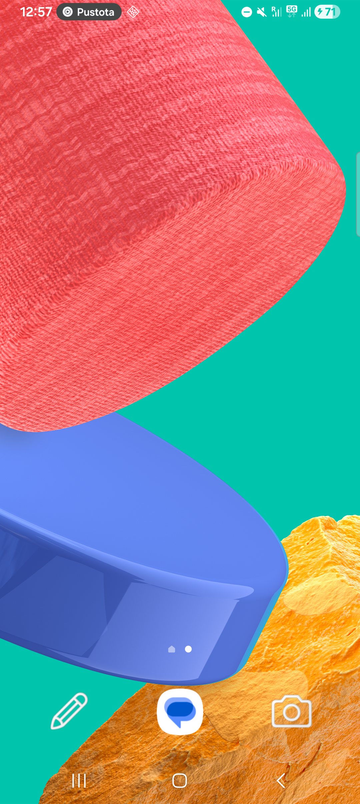
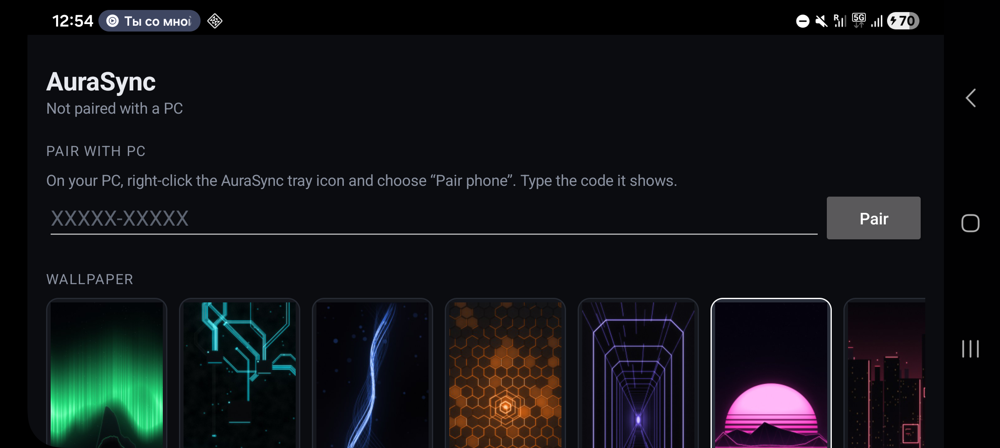

# AuraSync 🌌📱💻

> **Synchronized Dynamic RGB Live Wallpapers across Windows PC and Android Phone with ASUS ROG / G-Helper hardware aura lighting integration.**

[](#windows-pc-app)
[](#android-phone-app)
[](#architecture)
[](#architecture)
[](#pairing--cloud-sync)

---

## Overview

**AuraSync** brings cinematic, hardware-synchronized aura lighting to both your desktop and your phone. Instead of static wallpapers or battery-draining video loops, AuraSync renders live shader effects on top of custom optical emission masks:

* **Windows Desktop**: A lightweight DirectX 11 / HLSL wallpaper engine running seamlessly beneath your desktop icons without C-runtime overhead (~88 KB executable, under 25 MB RAM).
* **Android Live Wallpaper**: A battery-optimized native OpenGL ES 2.0 live wallpaper service that renders hardware vertex buffer aura animations with deep sleep and zero idle drain.
* **Real-Time Cross-Device Sync**: End-to-end encrypted MQTT sync via TLS with AES-256-GCM. Changing wallpapers, lighting effects, speeds, or colors on your PC updates your phone in real time (and vice-versa).
* **ASUS ROG & G-Helper Integration**: Hooks directly into G-Helper keyboard backlight state, matching your laptop's RGB keyboard mode (Static, Breathe, Color Cycle, Strobe, Rainbow, Comet) across both your monitor and smartphone.
* **On-Demand Manual Sync**: Includes an **"Update now"** trigger on mobile for instant wallpaper updates when switching themes on your PC.

---

## Screenshots

<p align="center">
  
  
  
</p>

<p align="center">
  
</p>

---

## Key Features

### 1. Dual-Layer Shader Pipeline
Traditional live wallpapers render heavy video loops or full-screen overlays that wash out the background. AuraSync uses an emissive split architecture:
- **Base Layer (`*_base.jpg`)**: High-contrast, rich base photographic or anime artwork.
- **Light Layer (`*_light.jpg`)**: Multi-scale optical radiance masks with strict luminance hierarchy. Only weapons (nichirin blades, lightsabers, cyberware LEDs), eyes, and cosmic flares bloom—retaining character depth and legibility while keeping floors and backgrounds dark and clean.
- **Hardware Shader (`aura.hlsl` / `GlRenderer.java`)**: Computes animated traveling light waves, white-hot specular cores, and color breathing at full display refresh rate.

### 2. Native Multi-Orientation Support
Every wallpaper pack includes:
- **Phone Portrait** (`1080 x 2408`): Hand-framed focal alignment for mobile grip.
- **Phone Landscape** (`2408 x 1080`): Full horizontal framing for phone docks, stands, and landscape gaming mode.
- **PC Desktop** (`3840 x 2160`): 4K Ultra-HD landscape rendering.

### 3. End-to-End Encrypted Cloud Link
- Pairing uses an effortless **10-character code** (e.g. `T9PWT-9ZQ3M`) generated by the PC app.
- Keys are derived via SHA-256 (`aurasync-key:<code >`), and all payloads are encrypted with **AES-256-GCM**.
- Operates over public TLS MQTT relays (`broker.hivemq.com`, `broker.emqx.io`, `test.mosquitto.org`) without needing port forwarding, server configuration, or account sign-ups.

---

## Wallpaper Catalog (19+ Included Packs)

AuraSync comes pre-loaded with custom handcrafted aura masks for popular anime, cinema, and aesthetic themes:

| Pack ID | Theme | Hero Accents | Default Color |
|---|---|---|---|
| `demon_slayer` | **Demon Slayer: Neo Tokyo** | Nichirin blade sheath, cyber visor rim, earring | 🟢 `#00ff9d` |
| `darth_vader` | **Star Wars: Sith Lord** | Vader vs. Ahsoka twin lightsaber blades | 🔴 `#ff0033` |
| `your_name` | **Your Name: Twilight Comet** | Splitting Tiamat comet head & atmospheric trail | 🔵 `#5e72e4` |
| `edgerunners` | **Cyberpunk Edgerunners** | Lucy's cyberware spine, David's illuminated collar | 🩵 `#00e5ff` |
| `gojo_purple` | **Jujutsu Kaisen: Gojo** | Hollow Purple sphere core, cursed energy lightning | 🟣 `#bf00ff` |
| `chainsaw_man` | **Chainsaw Man: Denji** | Chainsaw devil head, blood splatter & blade teeth | 🔴 `#ff1a1a` |
| `one_piece` | **One Piece: Gear 5** | Sun God Nika divine lightning & hair halo | 🟡 `#ffd700` |
| `spider_verse` | **Spider-Verse: Leap** | Miles Morales suit accents, neon skyscraper tops | 🔴 `#ff1744` |
| `interstellar` | **Interstellar: Gargantua** | Relativistic accretion disk & photon ring | 🩵 `#00e5ff` |
| `goku_ui` | **Dragon Ball: Ultra Instinct** | Kamehameha sphere core & divine silver aura | 🔵 `#00d2ff` |
| `aot_mikasa` | **Attack on Titan** | Ultrahard steel razor blade edges | 🔴 `#ff3838` |
| *Abstract* | **8 Cyberpunk / Synthwave Packs** | Circuit boards, neon horizons, hex cores, peaks | Various |

---

## Getting Started

### Windows PC App

1. Download or build `AuraSync.exe` from `pc-app/build/`.
2. Run `AuraSync.exe`. It will minimize to your system tray.
3. Right-click the tray icon to:
   - Select active wallpapers.
   - Pick lighting effects (`Static`, `Breathe`, `Color Cycle`, `Strobe`, `Rainbow`, `Comet`), speeds, and colors.
   - Toggle **Follow G-Helper** to synchronize with ASUS ROG laptop keyboard lighting.
   - Click **Pair phone** to reveal your unique 10-character pairing code.

### Android Phone App

1. Install `android/AuraPhoneSync.apk` on your Android device (Android 8.0+ / API 26+).
2. Open **AuraSync** on your phone.
3. Under **PC Sync & Pairing**, enter the 10-character code shown on your PC and tap **Pair**.
4. Tap **Set as wallpaper** to set AuraSync as your interactive home screen live wallpaper and matching lockscreen.
5. Tap **Update now** anytime you switch wallpapers on your PC for immediate on-demand synchronization!

---

## Building from Source

### PC App (Windows C++ / DirectX 11)

Built without the bloated C-Runtime (CRT) using MSVC Build Tools and the Windows SDK:

```cmd
cd pc-app
build.bat
```

*Outputs `pc-app\build\AuraSync.exe` (~88 KB standalone binary).*

### Android App (Native Java / OpenGL ES 2.0)

Built with plain Android command-line tools (no heavy Gradle wrapper required):

```bash
cd android
bash build.sh
# Or via Windows PowerShell:
# Execute aapt2, javac, d8, and apksigner
```

*Outputs `android\AuraPhoneSync.apk`.*

### Wallpaper Generator Toolkit (Python / OpenCV)

To create new aura masks with Gaussian optical gradients:

```cmd
python library/rebuild_improved.py
```

---

## Architecture & Code Structure

```
├── android/               # Native Android Live Wallpaper & Controller app
│   ├── src/.../           # AuraWallpaperService, GlRenderer, PcLink, MainActivity
│   ├── res/               # Android UI layouts, vector drawables
│   └── assets/packs/      # Embedded offline wallpaper library
├── pc-app/                # Native Windows DirectX 11 Desktop Wallpaper Engine
│   ├── src/               # main.cpp, aura.hlsl, link.h (MQTT client & crypto)
│   ├── res/               # App icons and Windows resources
│   └── build.bat          # Lightweight MSVC build script
├── ghelper-aurasync/      # G-Helper ASUS ROG control center integration fork
│   └── app/WallpaperForm.cs # Embedded AuraSync control form inside G-Helper
├── library/               # Python processing toolkit for optical radiance masks
│   ├── build_master_catalog.py # Master wallpaper compilation pipeline
│   ├── rebuild_improved.py    # Multi-scale Gaussian falloff mask generator
│   └── toolkit.py         # OpenCV image scaling, cropping, and blur kernels
├── docs/screenshots/      # Demonstration images and UI walkthroughs
└── README.md
```

---

## Security & Privacy

- **Zero telemetry**: No data, identifiers, or tracking are collected.
- **End-to-End Encryption**: Communication between PC and mobile travels through public MQTT brokers strictly encrypted with **AES-256-GCM** using keys generated on your device.
- **Power efficient**: The phone socket stays in deep sleep and only awakens when changing wallpaper or receiving sync signals. The rendering engine throttles to 0 FPS when the screen is turned off or occluded by fullscreen applications.

---

## Contributing

Contributions, new wallpaper packs, and shader improvements are welcome! Feel free to open an issue or pull request.

## License

This project is open-source under the MIT License. See [LICENSE](LICENSE) for details.
